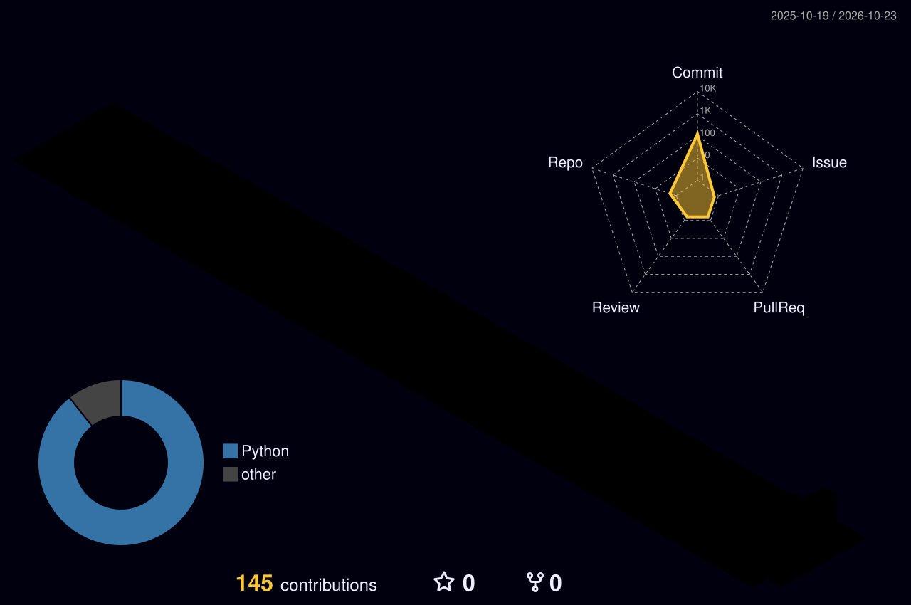
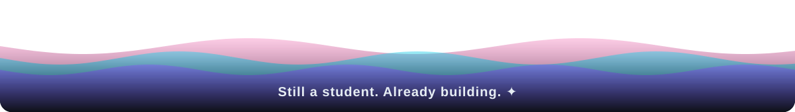

<!-- ═════════════ HERO (custom animated parallax SVG) ═════════════ -->


<div align="center">


<a href="mailto:ansumanmohanty2006@gmail.com"></a>
<a href="https://instagram.com/awwnsuman"></a>
<a href="https://github.com/ansuman-ai"></a>


</div>


<!-- ═════════════ ABOUT ═════════════ -->


<table>
<tr>
<td width="55%" valign="top">

```yaml
name:     Ansuman Mohanty   # aka Ansu
degree:   B.Sc. (Hons.) Computer Science & AI
campus:   Central University of Andhra Pradesh
batch:    2025 — 2029
from:     Odisha, India 🌊
loop:     learn → build → break → fix → ship
```

</td>
<td width="45%" valign="top">

🎙️ Building **real-time voice AI agents**  
🌌 Making **3D, scroll-driven web experiences**  
📱 Shipping **mobile apps** people actually use  
🛰️ Hacking on **multimodal AI** at hackathons  
🤝 Open to **internships & collabs**

</td>
</tr>
</table>


<!-- ═════════════ STACK ═════════════ -->


<div align="center">

<br/><br/>
<br/><br/>
<br/><br/>


</div>


<!-- ═════════════ FEATURED ═════════════ -->


<table>
<tr>
<td width="50%" valign="top" align="center">

### 🛰️ Space Track
<sub>SPACEBORNE FLOOD & DEBRIS ASSESSMENT</sub>

Rapid flood and debris damage mapping from satellite imagery, built for the Trishuli, Nepal flood (Copernicus EMSR927) at Multimodal AI Hackathon 2026.


[**→ repo**](https://github.com/ansuman-ai/space-track)

</td>
<td width="50%" valign="top" align="center">

### 🎙️ Voice-Agent
<sub>REAL-TIME CONVERSATIONAL AI</sub>

Low-latency voice agent over WebRTC with Sarvam STT/TTS and multi-LLM fallback, so it keeps talking even when one model fails.


🔒 <sub>private repo · demo on request</sub>

</td>
</tr>
<tr>
<td width="50%" valign="top" align="center">

### 🛡️ SafeNav
<sub>WOMEN-SAFETY NAVIGATION</sub>

Safety-aware routing with a 20 km danger radar, safe-path suggestions and one-tap SOS. Ships as an Android APK.


🔒 <sub>private repo · demo on request</sub>

</td>
<td width="50%" valign="top" align="center">

### 🌌 Digital Universe
<sub>3D SCROLL EXPERIENCE · TECHFEST</sub>

One continuous Three.js journey driven by GSAP ScrollTrigger: interactive core, live 3D network, cinematic loader, mobile-optimised.


🔒 <sub>private repo · demo on request</sub>

</td>
</tr>
</table>

<!-- ═════════════ LAB ═════════════ -->


<div align="center">

| Project | What it is | Access |
|:--|:--|:--|
| ✨ **Interactive** | Interactive web experience built with vanilla JS | [](https://interactive1-eosin.vercel.app) |
| 🔐 **Calc Vault** | Scientific calculator that secretly doubles as a biometric-locked vault | 🔒 private · demo on request |
| 🤖 **Cyborg** | Cyborg-themed web UI experiment | 🔒 private |
| 💡 **Ideate Landing** | Landing page design for Ideate | 🔒 private |

</div>


<!-- ═════════════ STATS ═════════════ -->


<div align="center">

<!-- 3D contribution city (generated by GitHub Action) -->



<!-- Snake (generated by GitHub Action) -->
<picture>
  <source media="(prefers-color-scheme: dark)" srcset="https://raw.githubusercontent.com/ansuman-ai/ansuman-ai/output/snake-dark.svg"/>
  
</picture>

</div>

<!-- ═════════════ ROADMAP ═════════════ -->
<details>
<summary><b>🧭 &nbsp;what I'm working towards</b></summary>
<br/>

```diff
+ Strong DSA & system design fundamentals
+ AI apps that run offline & on-device
+ First open-source contributions
+ More hackathon wins with my team
! Always: write code I can explain line by line
```

</details>

<br/>

